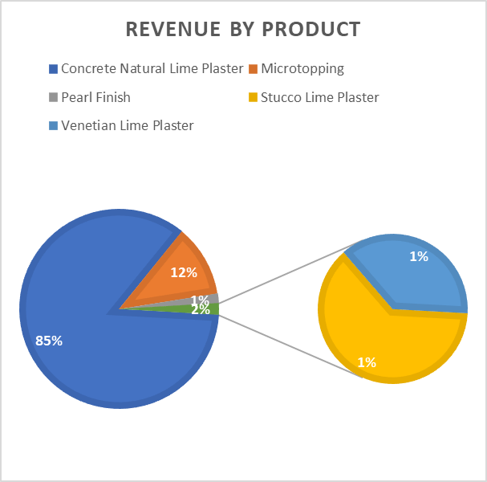
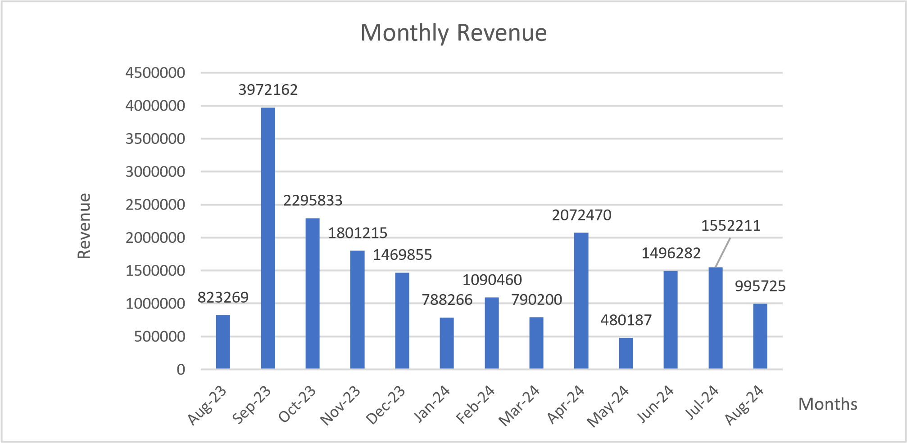
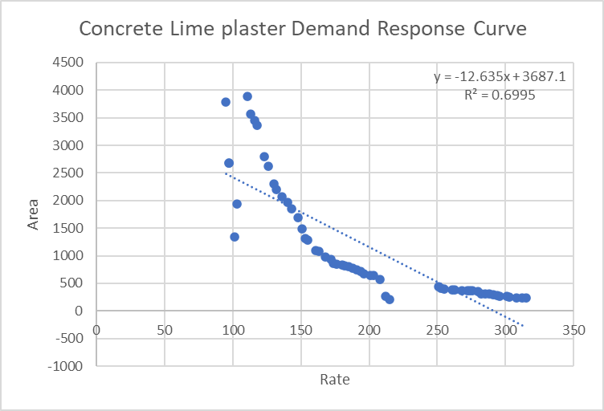
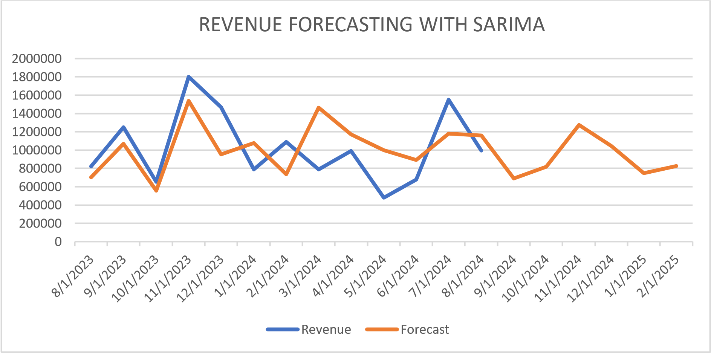
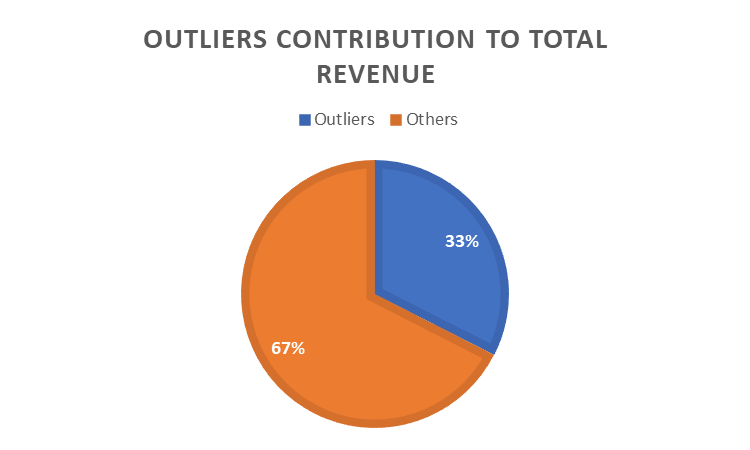
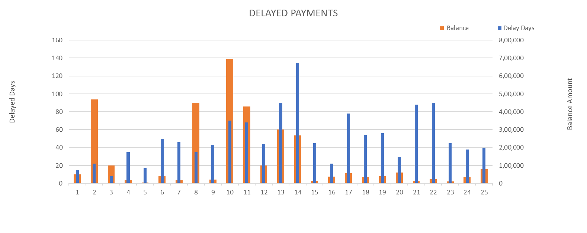

# Order Book & Cash Flow Analysis for a Premium Paint Services Business

A real-world business data project done for the IIT Madras *Business Data Management* course (Jul–Oct 2024). I worked directly with the owners of a small premium lime-plaster finishes company in Hyderabad, collected and cleaned their raw business data, and turned it into pricing, forecasting and cash-flow recommendations.

> **Privacy note:** The company is shown under a fictional name (**"LimeCraft Interiors"**), and all client and employee names are fictional. All figures and analysis are from the real project.

📄 **Full report:** [`reports/Final_Report.pdf`](reports/Final_Report.pdf). This repository presents the project **as submitted and evaluated** in the final submission (October 2024). Raw data is not published, to protect the client's confidentiality.

---

## The business problem

The company (founded 2023, two owners, work done through third-party vendors) had a **small order book** and **no system for managing cash flow**. Prices were set case by case, and payments often came in late. The owners wanted to grow revenue in a niche market.

## Data I worked with (Aug 2023 – Aug 2024)

| Dataset | Rows | How I built it |
| --- | --- | --- |
| Cash flow / cash book | 271 | Raw Excel sheets kept by the owner: date, site, customer type, amount, payment type |
| Product / orders | 194 | **Extracted from invoice PDFs** (Adobe Acrobat): product, surface, area (sqft), rate/sqft, amount |
| Pending payments | 25 | **Derived** by joining the cash flow and product data: invoice amount, balance, delay days |

Data cleaning included handling missing site codes, rates that varied for the same product (explained by vendor labour costs), and extreme order sizes (35 to 40,000 sqft).

## What I did

1. **Descriptive statistics & EDA:** monthly orders and revenue, revenue by product and by customer type
2. **Price optimisation:** built a demand-response curve (area vs rate) for each of the 5 products using linear and log-log regression with ANOVA, then found the price that maximises revenue
3. **Outlier analysis:** used box plots to find unusually large orders and investigated them with the owners
4. **Revenue forecasting:** built a SARIMA time-series model on monthly revenue
5. **Delayed payments analysis:** summary statistics and a combo chart of delay days against outstanding balance

## Key findings (from the final submission)

- **Pricing:** Revenue-maximising prices per sqft were **₹111** (Concrete Lime Plaster), ₹108 (Micro-topping), ₹197 (Pearl Finish), ₹326 (Stucco) and ₹150 (Venetian). Removing outliers improved the main product's model fit from R² 0.44 to 0.69.
- **Product mix:** One product (Concrete Lime Plaster) brings in **85% of revenue**.
- **Customer segments:** Commercial clients placed only 50 of 158 orders but brought in **58% of revenue**.
- **High-value outliers:** **5 large commercial orders** (new hospitals, hotels and offices) made up **10%** of commercial orders but **32.5%** of total revenue.
- **Cash flow risk:** Delayed payments were **₹33.7 lakh, about 17% of revenue**, with an average delay of **~51 days**.
- **Seasonality:** Orders follow a clear seasonal cycle, and the SARIMA model was used to plan for the slower months.

## Recommendations in the final submission

1. Standardise prices at the revenue-maximising rates for each product.
2. Target newly built commercial projects (hospitals, hotels, offices) with focused outreach.
3. Add a payment follow-up process, and hire someone for lead generation and collections.

## Selected charts

| Revenue by product | Monthly revenue |
| --- | --- |
|  |  |
| **Demand-response curve (price optimisation)** | **SARIMA revenue forecast** |
|  |  |
| **Outlier orders vs rest of revenue** | **Delayed payments (days vs balance)** |
|  |  |

More charts are in [`images/`](images/).

## Skills shown

Business problem framing · Data collection from a real client · PDF data extraction · Data cleaning & joining · Excel (regression, ANOVA, descriptive stats, charts) · Price optimisation · Time-series forecasting (SARIMA) · Outlier analysis · Communicating recommendations to business owners
